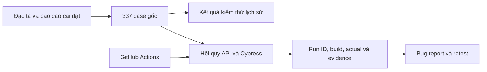

# SmileCare — Dự án kiểm thử hệ thống quản lý phòng khám

[](https://github.com/htrsng/KiemThu_PhongKham/actions/workflows/cypress.yml)

Dự án QA học tập cho ứng dụng nha khoa React/TypeScript, Express và MongoDB. Hồ sơ gồm kiểm thử gốc theo 20 use case và bộ hồi quy API/Cypress trên phiên bản mã hiện tại.

## Kết quả kiểm thử

| Đợt / nguồn | Kết quả | Báo cáo |
| --- | --- | --- |
| Excel kiểm thử gốc, ghi chú cuối 14/06/2026 | **337 case / 20 use case; 337 Pass theo kết quả đã ghi** | [Excel chuẩn hóa](docs/qa/history/manual-execution.xlsx) · [CSV](docs/qa/history/manual-execution.csv) |
| Báo cáo PDF gốc, tháng 6/2026 | **314 case: 288 Pass, 26 Fail** theo bảng tổng hợp | [PDF trang 36](docs/LT2_N02_KiemThu.pdf#page=36) |
| Hồi quy phiên bản hiện tại | **34 API Pass, 12 Cypress Pass, 2 defect test Fail** | [Test report](docs/qa/test-report.md) · [Execution Excel](docs/qa/runs/QA-20261113T075024810Z-b5db79/execution.xlsx) |

Hai hồ sơ gốc có số liệu khác nhau; giữ riêng từng kết quả và [ghi rõ đối chiếu](docs/qa/source-reconciliation.md). Kết quả cũ là kết quả lịch sử đã kiểm thử, không bị chuyển thành Not Run. `Not Run` trong workbook hồi quy chỉ nói đến các case chưa thực hiện lại trên build mới.

## Phạm vi và sản phẩm QA

- **UC1–UC4:** danh mục, lịch khám, tiếp đón/khám bệnh, thanh toán, tiền lương và báo cáo theo tài liệu gốc.
- [RTM 337 case](docs/qa/history/rtm.csv) nối use case → trang đặc tả → mã liên quan → kết quả lịch sử → evidence và automation hiện tại.
- [Test plan](docs/qa/test-plan.md), [bug register](docs/qa/bug-report.md), báo cáo CSV/Excel/JSON và bằng chứng trước/sau sửa lỗi.
- API positive/negative/RBAC; Cypress có selector ổn định, dữ liệu riêng từng test và kiểm tra dữ liệu lưu sau thao tác.
- BUG-004 có vòng New → Open → Fixed → Retest → Closed thực tế. BUG-002/003 vẫn Open; CI lưu artifacts khi test Fail.

70 thiết kế focused trong `testing/manual/test-cases.csv` hỗ trợ automation và có nội dung chồng lấp với 337 case gốc; không cộng thành 407 scenario độc lập. Hồi quy mới ưu tiên đăng nhập, phân quyền, lịch hẹn/check-in và thanh toán; chưa xác nhận lại toàn bộ 20 use case.

## Kiến trúc kiểm thử



## Chạy dự án

Yêu cầu Node.js 24, npm và MongoDB local cổng 27017. Từ thư mục gốc:

```sh
npm ci --prefix server
npm ci --prefix client
npm ci --prefix testing/e2e
node testing/scripts/prepare-env.js
node --env-file=testing/.env.test testing/scripts/seed-test-accounts.js
```

Mở backend và frontend ở hai terminal:

```sh
node --env-file=testing/.env.test server/server.js
```

```sh
npm --prefix client run dev
```

Chạy hồi quy khi API/UI sẵn sàng:

```sh
node testing/scripts/audit-qa.js
node --env-file=testing/.env.test testing/scripts/run-qa.js
```

Exit code 1 hiện phản ánh hai lỗi đang mở. [Hướng dẫn QA](docs/qa/README.md) ghi vị trí báo cáo và cách chạy riêng suite.

## Nguồn và đóng góp

[Đặc tả](docs/LT2_N02_DacTa.pdf), [cài đặt](docs/LT2_N02_CaiDat-1.pdf), [báo cáo kiểm thử](docs/LT2_N02_KiemThu.pdf) và Excel gốc được giữ để truy xuất nguồn. [Chỉ mục hồ sơ lịch sử](docs/qa/history/README.md) phân biệt dữ liệu gốc, phần chuẩn hóa và hồi quy mới.

Báo cáo gốc phân công Nguyễn Thị Huyền Trang làm kế hoạch, test case, manual/website testing và automation. Ứng dụng `client/`/`server/` là đối tượng kiểm thử; phần chuẩn hóa và automation bổ sung có AI hỗ trợ. Không nhận toàn bộ phần mềm là sản phẩm cá nhân tự phát triển. Không commit credential hoặc dữ liệu bệnh nhân thật.
