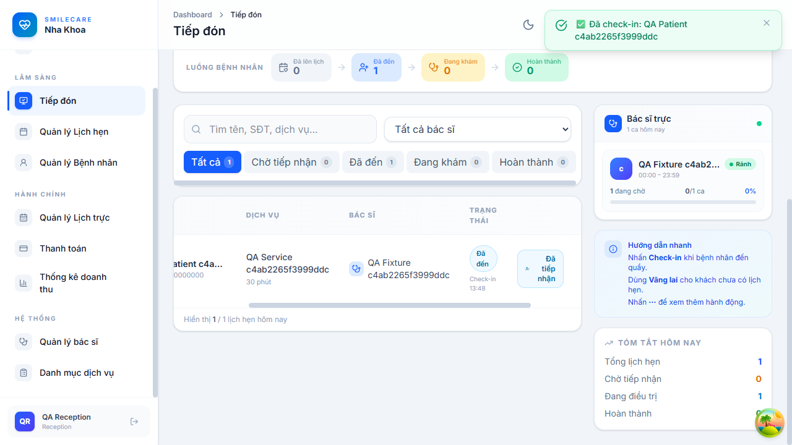

# SmileCare — Kiểm thử hệ thống quản lý phòng khám

[](https://github.com/htrsng/KiemThu_PhongKham/actions/workflows/cypress.yml)

Dự án kiểm thử ứng dụng phòng khám nha khoa, tập trung vào đăng nhập, phân quyền, lịch hẹn/check-in và thanh toán/hóa đơn. Giao diện dùng React/TypeScript; API dùng Express và MongoDB.

## Kết quả kiểm thử

Lần xác minh cục bộ ngày **13/11/2026**:

| Hạng mục | Kết quả |
| --- | --- |
| API regression | 26 Pass |
| Cypress UI | 10 Pass, không retry |
| Kiểm thử lỗi đang mở | 2 Fail: lùi trạng thái lịch hẹn và tạo trùng hóa đơn |
| Manual test design | 70 case, 31 yêu cầu; chưa thực thi manual |
| Frontend build | Pass |

Xem [test report](docs/qa/test-report.md), [bug reports](docs/qa/bug-report.md) và [bằng chứng thực thi](docs/qa/evidence/2026-11-13/README.md). Kết quả local và trạng thái CI được ghi riêng; hai lỗi còn mở nên chưa kết luận sẵn sàng phát hành.



## Cài đặt và chạy

Yêu cầu Node.js 24, npm và MongoDB cục bộ ở cổng 27017. Từ thư mục gốc:

```sh
npm ci --prefix server
npm ci --prefix client
npm ci --prefix testing/e2e
node testing/scripts/prepare-env.js
node --env-file=testing/.env.test testing/scripts/seed-test-accounts.js
```

Mở backend và frontend trong hai terminal:

```sh
node --env-file=testing/.env.test server/server.js
```

```sh
npm --prefix client run dev
```

Giao diện: `http://localhost:5173`. API: `http://localhost:5000/api`.

## Chạy kiểm thử

```sh
node testing/scripts/audit-qa.js
node testing/scripts/wait-for-app.js
node --env-file=testing/.env.test testing/scripts/run-api.js
```

Cypress chạy từ `testing/e2e`:

```sh
node --env-file=../.env.test node_modules/cypress/bin/cypress run
```

Lệnh tái hiện lỗi, vị trí báo cáo và cách dùng Postman nằm trong [hướng dẫn QA](docs/qa/README.md).

## Tài liệu và cấu trúc

| Đường dẫn | Nội dung |
| --- | --- |
| `client/`, `server/` | Ứng dụng được kiểm thử |
| `testing/api/`, `testing/e2e/` | API automation và Cypress UI |
| `testing/helpers/`, `testing/scripts/` | Fixture, chuẩn bị môi trường, chạy và xuất báo cáo |
| [Test cases](testing/manual/test-cases.csv) · [Execution](docs/qa/test-execution.xlsx) | Thiết kế và ghi nhận thực thi manual |
| [Test plan](docs/qa/test-plan.md) · [RTM](docs/qa/rtm.tsv) | Phạm vi, rủi ro, kỹ thuật và truy xuất yêu cầu |
| [API checklist](docs/qa/api-contract.md) · `testing/postman/` | Hợp đồng và collection API |
| `docs/qa/bugs/`, `docs/qa/evidence/` | Lỗi và bằng chứng |

Đây là dự án học tập QA. Tính lương, dashboard, hiệu năng, pentest và tương thích nhiều browser nằm ngoài phạm vi xác minh hiện tại. Credential được sinh cho DB QA riêng; không commit file môi trường.
