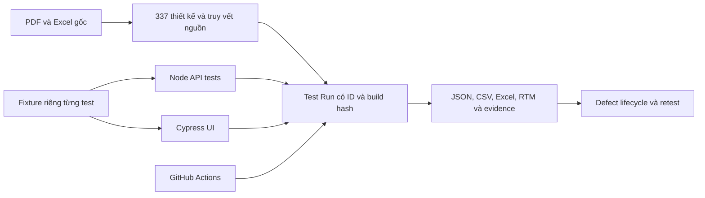

# SmileCare — Kiểm thử hệ thống quản lý phòng khám

[](https://github.com/htrsng/KiemThu_PhongKham/actions/workflows/cypress.yml)

Dự án QA cho ứng dụng nha khoa React/TypeScript, Express và MongoDB, phát triển từ đặc tả, báo cáo và Excel gốc trong `docs/`. Trọng tâm thực thi hiện tại: đăng nhập, phân quyền, lịch hẹn/check-in và thanh toán/hóa đơn.

## Kết quả và nguồn dữ liệu

| Hạng mục | Đã xác minh |
| --- | --- |
| Baseline gốc | **337 ID duy nhất / 20 use case**, chuẩn hóa từ Excel; manual vẫn Not Run |
| Chênh lệch PDF/Excel | PDF tổng hợp 314 nhưng chi tiết cộng được 334; Excel có 337. [Đối chiếu](docs/qa/source-reconciliation.md) |
| API | **34 Pass**, gồm positive/negative, token hết hạn, RBAC và dữ liệu đọc lại |
| Cypress | **12 Pass**, không retry; có luồng check-in UI → điều trị API → thanh toán UI |
| Defect regression | **2 Fail**, BUG-002/003 còn mở; không bị bỏ khỏi gate |
| Lifecycle đã thực hiện | BUG-004: New → Open → Fixed → Retest → Closed, có commit và evidence trước/sau |

[Run mới nhất](docs/qa/runs/QA-20261113T075024810Z-b5db79/summary.md): **46 Pass / 48 test tự động** trên Windows, ngày 13/11/2026. [Baseline trước sửa](docs/qa/runs/QA-20261113T072849286Z-115a62/summary.md) và [test report](docs/qa/test-report.md) được giữ riêng. Mười một test hạ tầng reporting/lifecycle đạt, không cộng vào số test nghiệp vụ.

Không nhận 337 nhãn Pass lịch sử là kết quả mới. Bộ 70 thiết kế hồi quy bổ trợ có nội dung chồng lấp với baseline gốc; không cộng thành 407 kịch bản độc lập. Còn lỗi High/P0 và manual chưa thực thi nên chưa kết luận sẵn sàng phát hành. CI sẽ Fail khi requirement test Fail, đồng thời vẫn lưu đầy đủ artifacts.

## Kiến trúc kiểm thử



API assertions ghi lại HTTP status và các trường nghiệp vụ an toàn, không ghi token/password. Mỗi run có thư mục riêng, không ghi đè lịch sử. RTM từng run liên kết use case → case → trạng thái automation → bug/evidence; `Manual status` được tách riêng và mapping automation luôn ghi Partial.

## Cài đặt và chạy

Yêu cầu Node.js 24, npm và MongoDB cục bộ cổng 27017. Tại thư mục gốc:

```sh
npm ci --prefix server
npm ci --prefix client
npm ci --prefix testing/e2e
node testing/scripts/prepare-env.js
node --env-file=testing/.env.test testing/scripts/seed-test-accounts.js
```

Mở hai terminal:

```sh
node --env-file=testing/.env.test server/server.js
```

```sh
npm --prefix client run dev
```

Sau khi API ở `http://localhost:5000/api` và UI ở `http://localhost:5173` sẵn sàng:

```sh
node testing/scripts/audit-qa.js
node --env-file=testing/.env.test testing/scripts/run-qa.js
```

Lệnh in Run ID và đường dẫn báo cáo; exit code 1 hiện phản ánh hai lỗi mở. Xem [hướng dẫn QA](docs/qa/README.md) để lọc suite, đọc Excel/RTM, chạy Postman và theo dõi lỗi.

## Tài liệu

| Tài liệu | Nội dung |
| --- | --- |
| [Đối chiếu nguồn](docs/qa/source-reconciliation.md) · [337 case](testing/manual/source-cases.csv) | Số liệu, provenance, priority và trường cần rà soát |
| [Test plan](docs/qa/test-plan.md) · [RTM yêu cầu](docs/qa/rtm.tsv) | Phạm vi, rủi ro và 31 yêu cầu hồi quy |
| [Workbook manual](docs/qa/test-execution.xlsx) | Hai inventory tách riêng, status/actual/evidence dành cho thực thi thật |
| [Test report](docs/qa/test-report.md) · [Bug register](docs/qa/bug-report.md) | Các run, giới hạn và lifecycle |
| [Execution Excel](docs/qa/runs/QA-20261113T075024810Z-b5db79/execution.xlsx) · [RTM có kết quả](docs/qa/runs/QA-20261113T075024810Z-b5db79/traceability.csv) | Run mới nhất, lọc theo case/use case/bug |
| [API checklist](docs/qa/api-contract.md) | Endpoint và assertions hiện có |

## Phạm vi đóng góp

Báo cáo gốc phân công Nguyễn Thị Huyền Trang làm kế hoạch, test case, manual/website testing và automation ([báo cáo kiểm thử, trang PDF 2](docs/LT2_N02_KiemThu.pdf#page=2)). Ứng dụng trong `client/` và `server/` là đối tượng kiểm thử. Bản nâng cấp QA chuẩn hóa dữ liệu gốc, reporting theo run, truy vết, regression và lifecycle có hỗ trợ AI; không nhận toàn bộ ứng dụng là phần mềm do cá nhân tự phát triển.

Đây là dự án học tập. Các phần payroll, báo cáo doanh thu, SMS, QR và nhiều chức năng y khoa trong tài liệu gốc chưa được xác minh đầy đủ trên bản ứng dụng hiện tại. Không commit `.env`, credential hoặc dữ liệu bệnh nhân thật.
